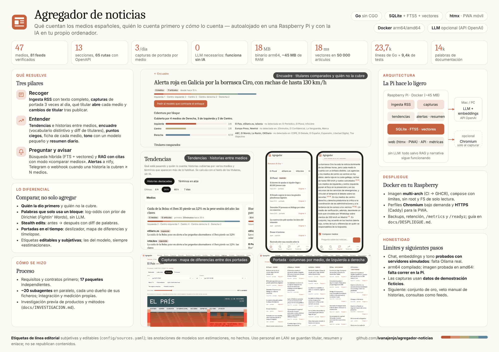
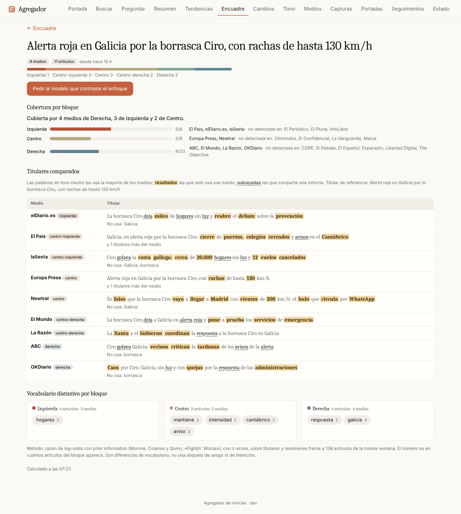
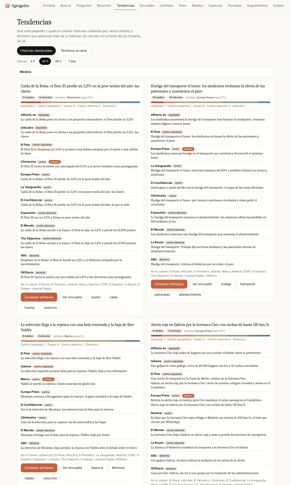
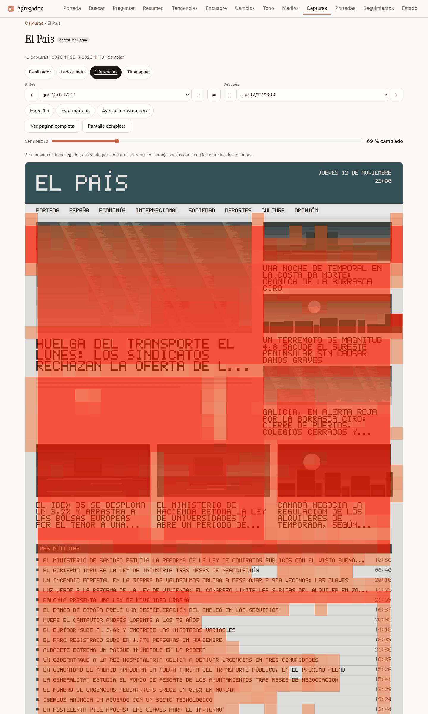

# Agregador de noticias

Qué cuentan los medios españoles, **quién lo cuenta primero y cómo lo cuenta**. Recoge noticias de 47 medios de todo el espectro,
guarda capturas de sus portadas, detecta tendencias e historias que cubren varios medios, compara el encuadre de cada uno y permite
buscar y preguntar (RAG). Es un único binario Go pensado para una **Raspberry Pi compartida**; el LLM corre en tu Mac/PC y todo funciona sin él.



> Resumen de una página: [docs/RESUMEN.pdf](docs/RESUMEN.pdf) · [docs/RESUMEN.html](docs/RESUMEN.html).
> Las capturas usan **datos de demostración ficticios** ([docs/DEMO.md](docs/DEMO.md)); todas están en [docs/screenshots](docs/screenshots/INDEX.md).

| Encuadre: titulares comparados | Tendencias: historias entre medios | Capturas: diferencias entre portadas |
|---|---|---|
|  |  |  |

## Qué hace
- **Recoger**: ingesta RSS con texto completo · capturas de portada 3 veces al día · qué titular abre cada medio · cambios de titular tras publicar.
- **Entender**: tendencias e historias · encuadre (vocabulario distintivo y diff de titulares) · puntos ciegos · ficha de medio · tono/intención con un modelo pequeño · resumen diario (+ feed Atom).
- **Preguntar y avisar**: búsqueda híbrida (FTS + vectores) · RAG con citas y modo «comparar medios» · seguimientos y alertas (ntfy, Telegram, webhook).
- **Operar**: retención, métricas Prometheus, `/readyz`, OpenAPI, exportación, backups, PWA móvil.

Detalle completo en [docs/FUNCIONALIDADES.md](docs/FUNCIONALIDADES.md).

## Arranque rápido
```bash
go run ./cmd/agregador                 # http://localhost:8080  (datos en ./data)
go run ./cmd/demo-seed -out ./demo-data && \
AGREGADOR_DATA_DIR=./demo-data AGREGADOR_SOURCES_FILE=./demo-data/sources.yaml \
AGREGADOR_INGEST_ENABLED=false AGREGADOR_SCREENSHOTS_ENABLED=false go run ./cmd/agregador   # con datos de demo
```
Configuración: `config/config.example.yaml` → `config/config.yaml`; cualquier valor se fija con `AGREGADOR_*`. Medios y feeds: `config/sources.yaml`.

## Conectar el LLM del Mac/PC (opcional)
Cualquier servidor con API compatible OpenAI (Ollama, LM Studio, llama.cpp, mlx-lm). Desde Docker usa la **IP** del Mac, no `macbook.local`:
```bash
AGREGADOR_EMBEDDINGS_BASE_URL=http://192.168.1.50:11434/v1 AGREGADOR_EMBEDDINGS_MODEL=nomic-embed-text \
AGREGADOR_CHAT_BASE_URL=http://192.168.1.50:11434/v1       AGREGADOR_CHAT_MODEL=qwen2.5:7b \
AGREGADOR_ANNOTATIONS_ENABLED=true go run ./cmd/agregador
```
Si el Mac está apagado, la ingesta sigue, la búsqueda cae a texto y los embeddings/anotaciones se completan al volver.

## Despliegue en la Raspberry (Docker)
```bash
git clone https://github.com/ivanajenjo/agregador-noticias.git && cd agregador-noticias
deploy/pi-install.sh --install-docker [--chromium] [--shots] [--https]
nano .env && docker compose up -d
```
Guía completa (límites de recursos, HTTPS/PWA, copias de seguridad, actualizaciones): [docs/DESPLIEGUE.md](docs/DESPLIEGUE.md).

## Documentación
| | |
|---|---|
| [REQUISITOS](docs/REQUISITOS.md) · [ARQUITECTURA](docs/ARQUITECTURA.md) | qué y por qué; mapa de paquetes |
| [FUNCIONALIDADES](docs/FUNCIONALIDADES.md) · [API](docs/API.md) · [openapi.yaml](docs/openapi.yaml) | referencia de uso |
| [DESPLIEGUE](docs/DESPLIEGUE.md) · [OPERACION](docs/OPERACION.md) | Pi, Docker, retención, métricas |
| [INVESTIGACION](docs/INVESTIGACION.md) | productos comparables, métodos, hoja de ruta |
| [CONTRIBUIR](docs/CONTRIBUIR.md) · [DEMO](docs/DEMO.md) | cómo extender; datos de demostración |

## Estado y límites (honestidad)
- Probado: `go vet` y `go test -race` en todo el repo (240 pruebas), ingesta con red real (47 medios), binario arm64 estático (18 MB), imagen Docker en amd64.
- **Sin probar todavía**: chat/embeddings/tono contra un LLM real (solo servidores simulados), ejecución en una Raspberry real, y las capturas contra portadas reales a escala.
- Los medios sin RSS válido (Público, SER, RTVE, Vozpópuli…) y los que solo responden a un navegador están documentados en `config/sources.yaml`.
- Las **etiquetas de línea editorial son subjetivas y editables**; las anotaciones de un modelo son estimaciones, no hechos.
- Uso personal en LAN: se guardan titular, resumen y enlace; no se republica contenido. No expongas el servicio a internet sin HTTPS y autenticación.
