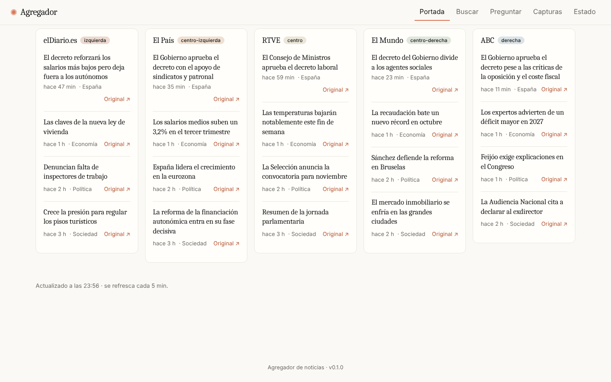

# Agregador de noticias

Agrega noticias de medios españoles de distintas líneas editoriales, guarda capturas periódicas de sus portadas,
las indexa (texto completo + vectores) y permite **buscar y preguntar (RAG)** para comparar cómo cuenta cada medio lo mismo.
Un único binario Go (sin CGO) pensado para una Raspberry Pi compartida; el LLM corre en otra máquina.



- Requisitos: [docs/REQUISITOS.md](docs/REQUISITOS.md) · Arquitectura: [docs/ARQUITECTURA.md](docs/ARQUITECTURA.md)
- Más capturas (escritorio/móvil, claro/oscuro): [docs/screenshots/](docs/screenshots/)

## Arranque rápido
```bash
go run ./cmd/agregador            # http://localhost:8080 (datos en ./data)
```
Configuración: copia `config/config.example.yaml` a `config/config.yaml`; cualquier valor se puede sobreescribir con `AGREGADOR_*`.
Medios y feeds: `config/sources.yaml`.

## Conectar el LLM del Mac/PC
Cualquier servidor con API OpenAI-compatible (Ollama, LM Studio, llama.cpp, mlx-lm):
```bash
AGREGADOR_EMBEDDINGS_BASE_URL=http://macbook.local:11434/v1 AGREGADOR_EMBEDDINGS_MODEL=nomic-embed-text \
AGREGADOR_CHAT_BASE_URL=http://macbook.local:11434/v1       AGREGADOR_CHAT_MODEL=qwen3:14b \
go run ./cmd/agregador
```
Si el Mac está apagado, la ingesta sigue y la búsqueda funciona con FTS; los embeddings se completan solos al volver.

## Despliegue en la Raspberry
```bash
make arm64                         # dist/agregador-arm64 (estático, ~17 MB)
docker compose up -d               # o con capturas: docker compose --profile shots up -d
```
Las capturas usan un Chromium **bajo demanda**: sidecar `chrome` (perfil `shots`) o Chromium remoto en el Mac (`screenshots.remote_url`).
La PWA solo se instala por HTTPS o localhost (service worker).

## Estado y siguientes pasos
Hecho: ingesta RSS + texto completo, capturas, FTS5 + búsqueda vectorial híbrida, RAG con comparación por línea editorial, UI móvil/PWA.
Previsto: anotación de sesgo/intención por noticia con un modelo pequeño (esquema `article_annotations` ya creado), cuantización int8 de vectores.
Notas: Público, La Razón, SER, RTVE y otros no tenían RSS válido al verificar (ver `config/sources.yaml`); las etiquetas de línea editorial son subjetivas y editables.
